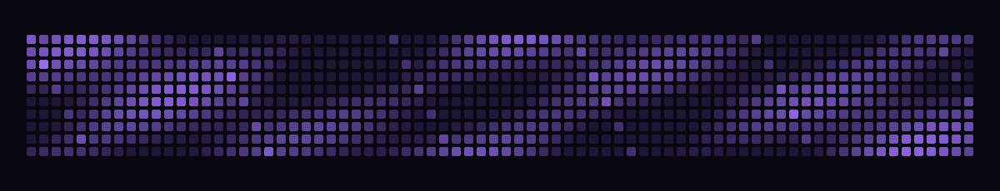

  
   
   
  
  
  <h1>prism1337</h1>
  
<strong>Minecraft client developer</strong>

  <a href="https://github.com/slepy2968-hub">github profile</a>

---

### about

I develop Minecraft clients and share project updates here.

### current project

**[prism1337](https://github.com/slepy2968-hub/prism1337)**  
Minecraft client development · in progress
